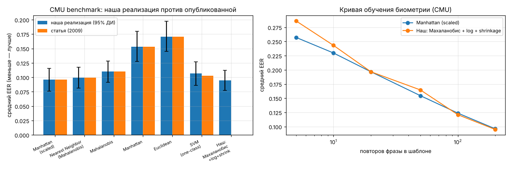
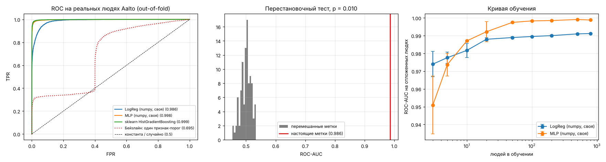
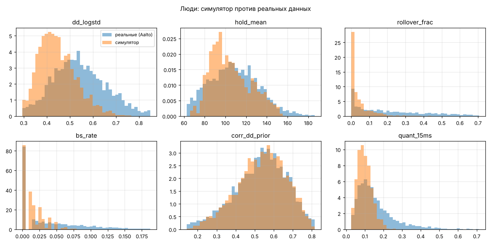
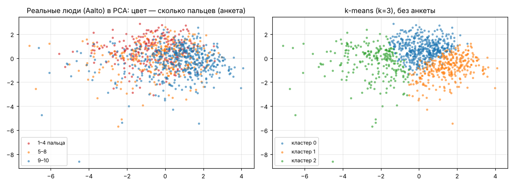
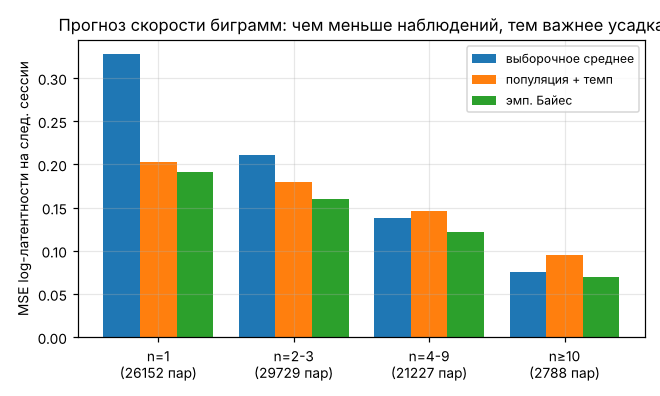

# Эксперименты на открытых данных

Дата: 2026-11-11 01:46.

## 1. Биометрия на CMU Keystroke Benchmark

51 человек × 400 повторов пароля `.tie5Roanl` (8 сессий в разные дни). Протокол статьи Killourhy & Maxion (2009): шаблон — первые 200 повторов, свои — остальные 200, самозванцы — первые 5 повторов каждого из 50 других. EER — где доля пропущенных чужих равна доле отвергнутых своих (меньше — лучше).

| детектор | наш EER | 95% ДИ (бутстреп по людям) | EER в статье |
|---|---|---|---|
| Manhattan (scaled) | 0.096 | [0.076; 0.116] | 0.096 |
| Nearest Neighbor (Mahalanobis) | 0.100 | [0.081; 0.118] | 0.100 |
| Mahalanobis | 0.110 | [0.091; 0.128] | 0.110 |
| Manhattan | 0.153 | [0.128; 0.180] | 0.153 |
| Euclidean | 0.171 | [0.145; 0.198] | 0.171 |
| Наш: Махаланобис + log + shrinkage | 0.095 | [0.078; 0.112] | — |
| SVM (one-class) | 0.107 | [0.086; 0.127] | 0.102 |

Совпадение с опубликованными числами подтверждает, что детекторы и метрика реализованы верно.

**Сколько повторов нужно в шаблоне:**

| повторов | Manhattan (scaled) | Наш: Махаланобис + log + shrinkage |
|---|---|---|
| 5 | 0.257 | 0.286 |
| 10 | 0.230 | 0.243 |
| 20 | 0.197 | 0.197 |
| 50 | 0.155 | 0.165 |
| 100 | 0.124 | 0.121 |
| 200 | 0.096 | 0.095 |

## 2. Античит на реальных людях (Aalto 136M Keystrokes)

Люди: 1000 случайных участников Aalto (QWERTY, физическая клавиатура), 15000 попыток. Читеры: 4956 попыток ботов 7 типов, печатающих **те же предложения**. 5 фолдов, разбиение по людям/ботам: тестовые люди не участвуют в обучении.

| модель | ROC-AUC | TPR при FPR=1% | Brier | ECE |
|---|---|---|---|---|
| LogReg (numpy, своя) | 0.986 | 0.756 | 0.047 | 0.056 |
| MLP (numpy, своя) | 0.998 | 0.968 | 0.014 | 0.011 |
| sklearn RandomForest | 0.999 | 0.974 | 0.014 | 0.026 |
| sklearn HistGradientBoosting | 0.999 | 0.978 | 0.010 | 0.004 |
| Бейзлайн: один признак-порог | 0.695 | 0.295 | — | — |
| Байес. LogReg + Платт (итоговая) | 0.986 | 0.755 | 0.040 | 0.012 |
| Бейзлайн: константа (доля читеров) | 0.500 | 0.010 | 0.187 | 0.000 |

Бейзлайн «один признак» чаще всего выбирал `dd_logstd`.

**Перестановочный тест.** Метки «человек/бот» перемешивались по группам 99 раз, модель обучалась заново: средний ROC-AUC 0.500, максимум 0.533; на настоящих метках — **0.986** (p = 0.010). Ни одна перестановка не дошла до настоящего результата: модель выучила закономерность, а не шум.

**Кривая обучения** (отложенные люди фолда 1; «P>0.5» — доля людей, ошибочно названных читерами):

| людей в обучении | AUC LogReg | P>0.5 LogReg | AUC MLP | P>0.5 MLP |
|---|---|---|---|---|
| 3 | 0.974 | 0.206 | 0.951 | 0.436 |
| 5 | 0.978 | 0.157 | 0.974 | 0.301 |
| 10 | 0.982 | 0.102 | 0.987 | 0.154 |
| 20 | 0.988 | 0.092 | 0.992 | 0.112 |
| 50 | 0.989 | 0.067 | 0.997 | 0.045 |
| 100 | 0.990 | 0.067 | 0.998 | 0.032 |
| 200 | 0.990 | 0.069 | 0.999 | 0.027 |
| 500 | 0.991 | 0.060 | 0.999 | 0.016 |
| 800 | 0.991 | 0.058 | 0.999 | 0.014 |

**Перенос «синтетика → реальные люди»** (одни и те же тестовые люди и боты Aalto):

| модель | ROC-AUC на Aalto | доля реальных людей с P>0.5 | доля ботов с P>0.5 |
|---|---|---|---|
| обучена на синтетике | 0.912 | 0.357 | 0.927 |
| обучена на Aalto | 0.991 | 0.058 | 0.961 |

Модель, обученная только на симуляторе, хуже работает на реальных людях — поэтому реальные данные (Aalto + свои участники) необходимы.

**Медиана P(читер) по типам** (итоговая калиброванная модель):

| тип | медиана P |
|---|---|
| human | 0.003 |
| ahk | 0.992 |
| bigram | 0.441 |
| const | 0.993 |
| gauss | 0.998 |
| humanized | 0.981 |
| replay | 0.668 |
| uniform | 0.994 |

## 3. Стили печати на реальных людях

1000 человек; вектор человека — средние 8 признаков. Анкета Aalto («сколько пальцев») используется только для проверки, не для обучения.

| сравнение | значение |
|---|---|
| ARI(k-means, пальцы по анкете) | 0.053 |
| ARI(GMM, пальцы по анкете) | 0.081 |
| ARI(своя k-means, sklearn k-means) | 0.992 |
| инерция своей k-means (меньше — лучше) | 5179.367 |
| инерция sklearn k-means | 5179.443 |

Кластеры почти не совпадают с ответом «сколько пальцев»: число пальцев само по себе слабо определяет стиль, кластеры делят людей скорее по скорости и перекрытиям клавиш (см. таблицу). Своя k-means и sklearn дают одинаковое разбиение и одинаковую инерцию.

| k | силуэт |
|---|---|
| 2 | 0.283 |
| 3 | 0.198 |
| 4 | 0.210 |
| 5 | 0.187 |

| кластер | людей | wpm | hold_mean | dd_logstd | rollover_frac | доля «9–10 пальцев» |
|---|---|---|---|---|---|---|
| 0 | 456 | 56.958 | 101.225 | 0.535 | 0.122 | 0.423 |
| 1 | 312 | 84.240 | 122.531 | 0.515 | 0.429 | 0.731 |
| 2 | 232 | 35.191 | 121.922 | 0.689 | 0.104 | 0.302 |

## 4. Слабые биграммы: эмпирический Байес на реальных людях

Оценка по первым 10 предложениям участника, проверка — прогноз латентности биграмм в последних 5.

| метод | n=1 | n=2-3 | n=4-9 | n≥10 |
|---|---|---|---|---|
| выборочное среднее | 0.328 | 0.211 | 0.138 | 0.075 |
| популяция + темп | 0.203 | 0.180 | 0.146 | 0.095 |
| эмп. Байес | 0.191 | 0.160 | 0.121 | 0.069 |

## 5. Итоговая модель для сайта

Обучена на людях Aalto + синтетических людях (русский и английский, чтобы язык текста не стал признаком бота) + ботах на тех же текстах. Записана в `collector/model/anticheat.json`, популяционные средние биграмм — в `collector/model/bigram_prior.json`.

| показатель | значение |
|---|---|
| oof_auc | 0.971 |
| median_p_real_humans | 0.004 |
| median_p_sim_humans | 0.125 |
| median_p_bots | 0.944 |

## 6. Проверка на своих участниках (выгрузка сайта)

| модель | attempts | people | median_p_humans | share_humans_p>0.5 |
|---|---|---|---|---|
| новая модель (Aalto + синтетика) | 48 | 3 | 0.098 | 0.104 |
| предыдущая модель (только синтетика) | 48 | 3 | 0.056 | 0.229 |

Своих участников (печать на русском) модель не видела ни разу. Доля настоящих людей, ошибочно получивших P > 50%, снизилась с 23% до 10%. Участников пока трое, поэтому вывод предварительный.

---
Данные: CMU Keystroke Dynamics Benchmark (Killourhy & Maxion, DSN 2009, CC-BY-ND 2.0); Aalto 136M Keystrokes (Dhakal, Feit, Kristensson, Oulasvirta, CHI 2018, некоммерческое использование с указанием авторов).
