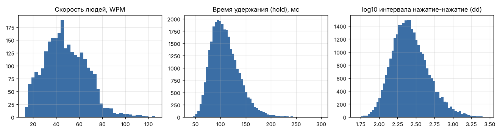
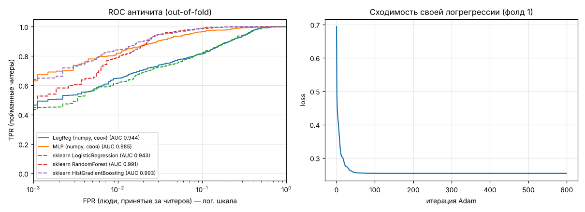
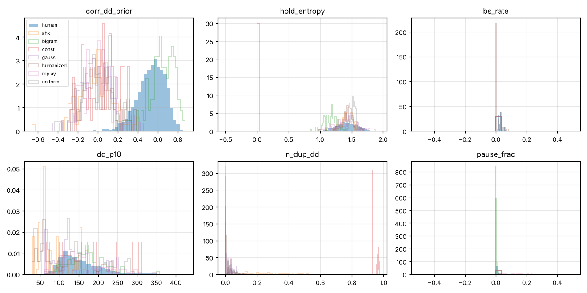
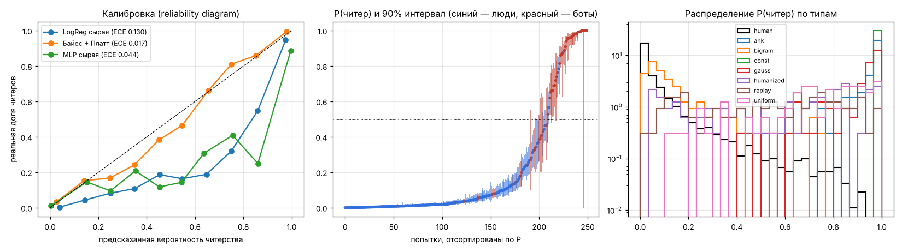
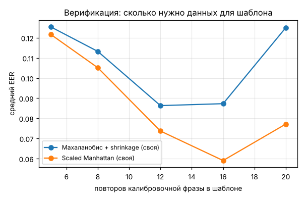
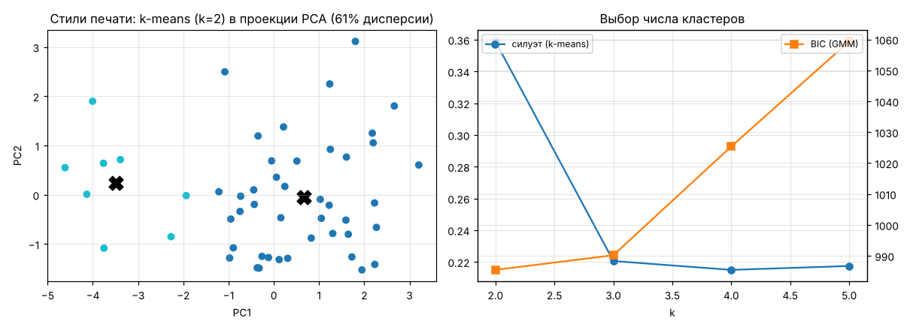
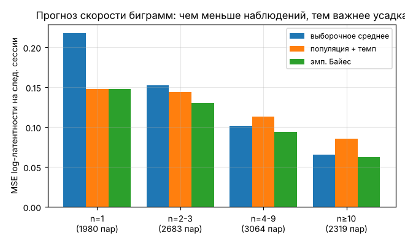

# Результаты экспериментов

Источник людей: **СИНТЕТИЧЕСКИЕ пользователи (симулятор) — для отладки пайплайна**. Негативный класс: сгенерированные боты 7 типов.
Дата прогона: 2026-10-29 01:36.

## 0. Датасет

| показатель | значение |
|---|---|
| human_attempts | 2700 |
| users | 50 |
| users_with_3plus_sessions | 50 |
| calib_attempts | 1500 |
| text_attempts | 1200 |
| keystrokes | 131496 |
| cheat_attempts | 672 |
| cheat_by_type | {'ahk': 96, 'bigram': 96, 'const': 96, 'gauss': 96, 'humanized': 96, 'replay': 96, 'uniform': 96} |
| sources | ['bot', 'sim'] |

## 1. Античит: человек или бот

Валидация: 5 фолдов, разбиение по группам (пользователь / экземпляр бота) — одна и та же группа не попадает одновременно в train и test. Метрики out-of-fold.

| модель | ROC-AUC | F1@0.5 | Accuracy@0.5 | FPR@0.5 | TPR при FPR=1% |
|---|---|---|---|---|---|
| LogReg (numpy, своя) | 0.944 | 0.718 | 0.869 | 0.122 | 0.649 |
| MLP (numpy, своя) | 0.985 | 0.873 | 0.946 | 0.051 | 0.818 |
| sklearn LogisticRegression | 0.943 | 0.711 | 0.862 | 0.136 | 0.616 |
| sklearn RandomForest | 0.991 | 0.910 | 0.962 | 0.035 | 0.790 |
| sklearn HistGradientBoosting | 0.993 | 0.909 | 0.964 | 0.021 | 0.842 |

**Доля пойманных читеров по типам** (порог: ложно заблокированы ~1% людей):

| модель | ahk | bigram | const | gauss | humanized | replay | uniform |
|---|---|---|---|---|---|---|---|
| LogReg (numpy, своя) | 1.000 | 0.031 | 1.000 | 0.927 | 0.490 | 0.375 | 0.719 |
| MLP (numpy, своя) | 1.000 | 0.417 | 1.000 | 0.958 | 0.823 | 0.573 | 0.958 |
| sklearn LogisticRegression | 1.000 | 0.042 | 1.000 | 0.885 | 0.427 | 0.417 | 0.542 |
| sklearn RandomForest | 0.958 | 0.312 | 1.000 | 0.979 | 0.771 | 0.677 | 0.833 |
| sklearn HistGradientBoosting | 0.969 | 0.510 | 1.000 | 0.979 | 0.823 | 0.688 | 0.927 |

**Обобщение на неизвестный тип бота** (тип исключён из обучения, ROC-AUC на людях vs этот тип):

| исключённый тип | LogReg (numpy, своя) | sklearn RandomForest |
|---|---|---|
| ahk | 0.096 | 0.993 |
| bigram | 0.281 | 0.558 |
| const | 1.000 | 0.991 |
| gauss | 0.997 | 0.997 |
| humanized | 0.791 | 0.975 |
| replay | 0.847 | 0.951 |
| uniform | 0.976 | 0.992 |

**Самые весомые признаки логрегрессии** (стандартизованные веса, + = «похоже на бота»):

| признак | вес |
|---|---|
| corr_dd_prior | -1.349 |
| hold_entropy | -0.933 |
| bs_rate | -0.650 |
| dd_p10 | 0.458 |
| n_dup_dd | 0.426 |
| pause_frac | -0.409 |
| rollover_frac | 0.395 |
| dd_entropy | -0.365 |
| hold_kurt | 0.361 |
| hold_p90 | -0.309 |
| dd_logstd | -0.294 |
| hold_std | -0.285 |

### 1.1. Вероятность читерства и доверительный интервал

Вместо ответа «читер / не читер» модель выдаёт **P(читер)** и **90% интервал** для неё. Интервал получается из апостериорного распределения весов байесовской логрегрессии (аппроксимация Лапласа: логит ~ N(m, xᵀΣx)), вероятность калибруется методом Платта (кросс-фиттинг по фолдам). Метрики вероятностей: Brier и log-loss (меньше — лучше), ECE — средний разрыв между прогнозом и реальной частотой.

| модель | Brier | log-loss | ECE | ROC-AUC |
|---|---|---|---|---|
| LogReg, сырая вероятность | 0.094 | 0.300 | 0.130 | 0.944 |
| Байес. LogReg (Лаплас), без калибровки | 0.094 | 0.300 | 0.130 | 0.944 |
| Байес. LogReg + Платт (итоговая) | 0.062 | 0.211 | 0.017 | 0.943 |
| MLP, сырая вероятность | 0.046 | 0.227 | 0.044 | 0.985 |

**Интервалы.** Если 90% интервал накрывает 50%, модель честно говорит «не уверена».

| показатель | значение |
|---|---|
| средняя ширина 90% интервала | 0.069 |
| медианная ширина | 0.029 |
| доля «неуверенных» (интервал накрывает 50%) | 0.044 |
| ошибка среди уверенных | 0.063 |
| ошибка среди неуверенных | 0.392 |

Среди «уверенных» попыток ошибка 6.3%, среди «неуверенных» — 39.2%: интервал действительно отделяет надёжные оценки от сомнительных.

**Ошибка по квартилям неопределённости логита** (√xᵀΣx):

| квартиль неопределённости | ср. ширина | |p - y| (ср.) | n |
|---|---|---|---|
| 1 | 0.053 | 0.157 | 843 |
| 2 | 0.059 | 0.125 | 843 |
| 3 | 0.070 | 0.124 | 843 |
| 4 | 0.092 | 0.087 | 843 |

Ошибка не растёт с шириной логит-интервала: интервал Лапласа отражает неопределённость **параметров** модели (насколько попытка непохожа на обучающие), а не перекрытие классов. Самые «далёкие» попытки — грубые боты, на них модель ошибается редко. Ошибки же сосредоточены около P ≈ 50%, что и ловит критерий «интервал накрывает 50%».

**P(читер) по типам попыток** (доля читеров в данных π = 0.20; последний столбец — та же медиана после сдвига априорной вероятности к 5% читеров по формуле Байеса):

| тип | ср. P | медиана P | медианный 90% интервал | медиана P при π=5% |
|---|---|---|---|---|
| human | 0.077 | 0.024 | [0.02; 0.04] | 0.005 |
| ahk | 0.956 | 0.977 | [0.92; 0.99] | 0.900 |
| bigram | 0.141 | 0.090 | [0.06; 0.13] | 0.020 |
| const | 1.000 | 1.000 | [1.00; 1.00] | 1.000 |
| gauss | 0.904 | 0.961 | [0.92; 0.98] | 0.838 |
| humanized | 0.567 | 0.653 | [0.52; 0.79] | 0.285 |
| replay | 0.531 | 0.570 | [0.46; 0.68] | 0.219 |
| uniform | 0.732 | 0.776 | [0.63; 0.87] | 0.423 |

**Проверка интервалов бутстрепом** (30 логрегрессий на бутстреп-выборках пользователей/ботов, фолд 1):

| показатель | значение |
|---|---|
| ширина логит-интервала, Лаплас (ср.) | 2.123 |
| ширина логит-интервала, бутстреп (ср.) | 2.098 |
| корреляция ширин | 0.152 |

## 2. Биометрическая верификация (калибровочная фраза)

Шаблон строится по прошлым сессиям, проверка — на последней сессии пользователя; «самозванцы» — первые 5 попыток каждого другого пользователя. Метрика — EER (меньше = лучше).

| детектор | EER (шаблон: все прошлые сессии) | std | польз. |
|---|---|---|---|
| Махаланобис + shrinkage (своя) | 0.105 | 0.119 | 49 |
| Scaled Manhattan (своя) | 0.115 | 0.160 | 49 |
| sklearn OneClassSVM | 0.107 | 0.124 | 49 |
| sklearn IsolationForest | 0.122 | 0.141 | 49 |

**Влияние «дня»** — шаблон одинаковый (первая половина 1-й сессии), меняется источник своих тестовых попыток:

| детектор | тест в той же сессии | тест в другой сессии |
|---|---|---|
| Махаланобис + shrinkage (своя) | 0.080 | 0.092 |
| Scaled Manhattan (своя) | 0.064 | 0.099 |
| sklearn OneClassSVM | 0.077 | 0.088 |
| sklearn IsolationForest | 0.158 | 0.225 |

При проверке в той же сессии EER ниже (0.080 против 0.092): оценка «внутри дня» оптимистична, поэтому протокол сбора требует нескольких сессий в разные дни.

## 3. Профилирование: стили печати (кластеризация)

Число кластеров по силуэту: **k = 2**.

| k | силуэт (k-means) | BIC (GMM) | инерция |
|---|---|---|---|
| 2 | 0.359 | 985.461 | 279.877 |
| 3 | 0.221 | 990.199 | 220.943 |
| 4 | 0.215 | 1025.375 | 188.089 |
| 5 | 0.217 | 1059.349 | 165.876 |

| сравнение | значение |
|---|---|
| ARI(own kmeans, sklearn kmeans) | 0.475 |
| ARI(own kmeans, own GMM) | 0.903 |
| own_inertia | 279.877 |
| sklearn_inertia | 285.964 |
| ARI(k-means k=3, истинный архетип симулятора) | 0.910 |
| ARI(GMM k=3, истинный архетип симулятора) | 0.709 |
| ARI(выбранная модель, истинный архетип) | 0.314 |

**Профили кластеров (средние):**

| cluster | size | wpm | hold_mean | dd_logstd | rollover_frac | bs_rate | pause_frac | space_dd_ratio | hold_logstd |
|---|---|---|---|---|---|---|---|---|---|
| 0 | 42 | 50.832 | 100.886 | 0.422 | 0.047 | 0.014 | 0.004 | 0.973 | 0.201 |
| 1 | 8 | 22.345 | 127.902 | 0.559 | 0.013 | 0.025 | 0.113 | 0.942 | 0.200 |

## 4. Слабые биграммы: эмпирический Байес

Оценка «скорости» каждой биграммы по прошлым сессиям, проверка — насколько хорошо она предсказывает латентность на следующей сессии (MSE log-латентности).

| метод | n=1 | n=2-3 | n=4-9 | n≥10 |
|---|---|---|---|---|
| выборочное среднее | 0.218 | 0.152 | 0.102 | 0.065 |
| популяция + темп | 0.148 | 0.144 | 0.113 | 0.086 |
| эмп. Байес | 0.148 | 0.130 | 0.094 | 0.062 |

- spearman(оценка слабости, истинная особенность) — Байес: **0.558**

- spearman(оценка слабости, истинная особенность) — сырое среднее: **0.565**

**Пример персонального отчёта** (sim000):

| биграмма | оценка, мс | ожидалось, мс | P(слабая) |
|---|---|---|---|
| A/Ф → N/Т | 629 | 371 | 1.000 |
| K/Л → S/Ы | 515 | 322 | 1.000 |
| S/Ы → S/Ы | 867 | 548 | 1.000 |
| G/П → L/Д | 563 | 373 | 0.990 |
| O/Щ → ␣ | 701 | 495 | 1.000 |
| I/Ш → T/Е | 471 | 341 | 1.000 |
| L/Д → A/Ф | 608 | 447 | 1.000 |
| W/Ц → H/Р | 512 | 388 | 1.000 |

Сгенерированное упражнение: _he than that with us into network any model like now work what way_
