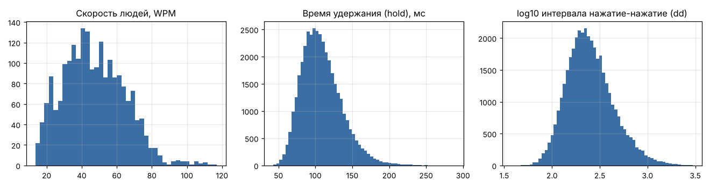
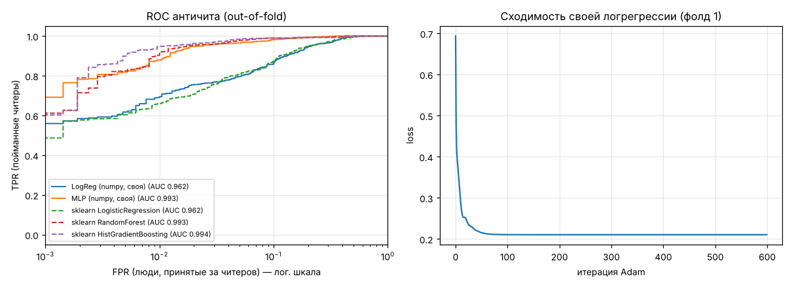
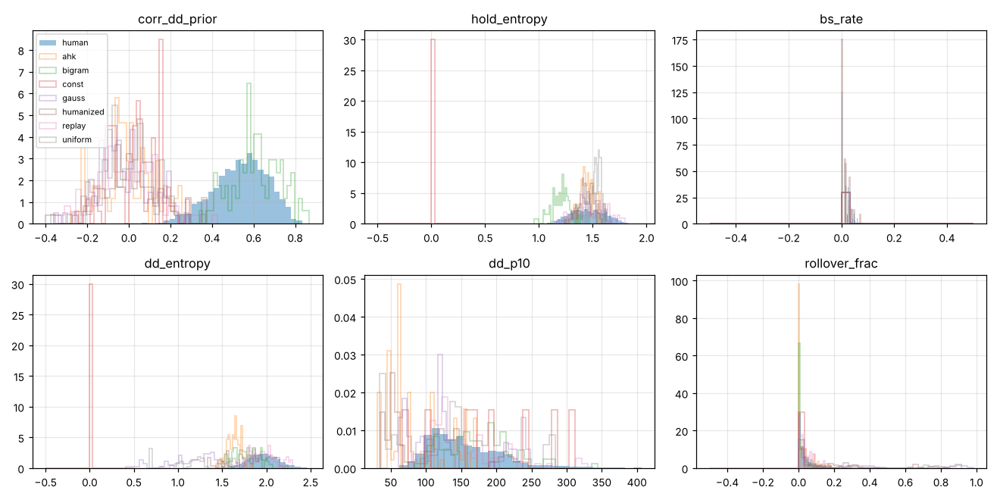
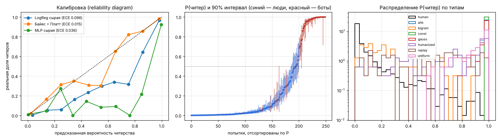
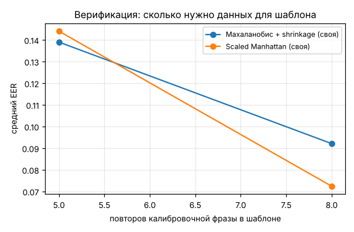
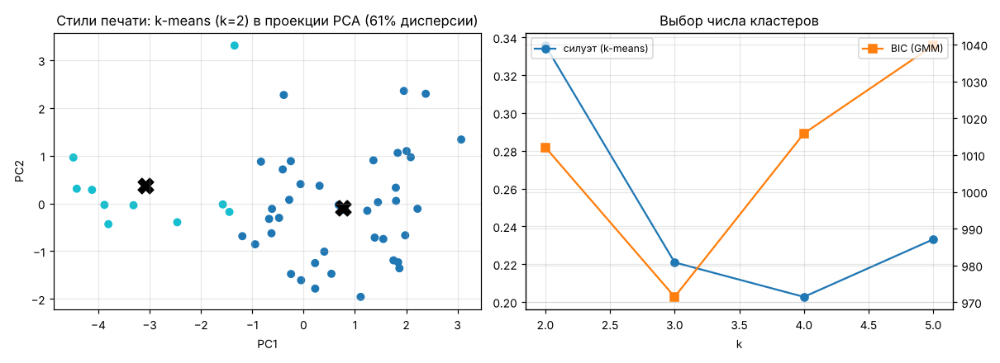
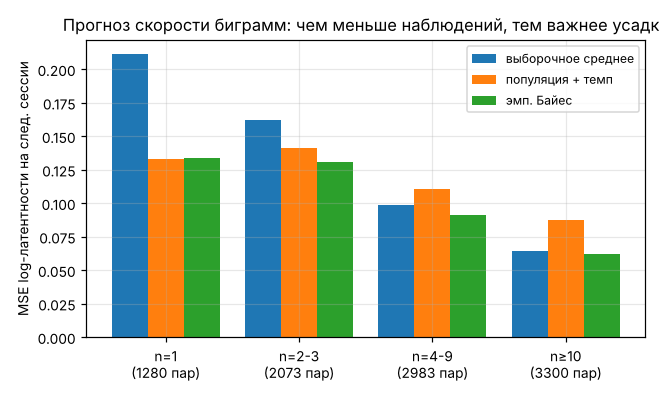

# Результаты экспериментов

Источник людей: **СИНТЕТИЧЕСКИЕ пользователи (симулятор) — для отладки пайплайна**. Негативный класс: сгенерированные боты 7 типов.
Дата прогона: 2026-11-10 23:55.

## 0. Датасет

| показатель | значение |
|---|---|
| human_attempts | 2100 |
| users | 50 |
| users_with_3plus_sessions | 50 |
| calib_attempts | 900 |
| text_attempts | 1200 |
| keystrokes | 139950 |
| cheat_attempts | 672 |
| cheat_by_type | {'ahk': 96, 'bigram': 96, 'const': 96, 'gauss': 96, 'humanized': 96, 'replay': 96, 'uniform': 96} |
| sources | ['bot', 'sim'] |

## 1. Античит: человек или бот

Валидация: 5 фолдов, разбиение по группам (пользователь / экземпляр бота) — одна и та же группа не попадает одновременно в train и test. Метрики out-of-fold.

| модель | ROC-AUC | F1@0.5 | Accuracy@0.5 | FPR@0.5 | TPR при FPR=1% |
|---|---|---|---|---|---|
| LogReg (numpy, своя) | 0.962 | 0.796 | 0.892 | 0.101 | 0.695 |
| MLP (numpy, своя) | 0.993 | 0.918 | 0.958 | 0.043 | 0.879 |
| sklearn LogisticRegression | 0.962 | 0.800 | 0.892 | 0.107 | 0.661 |
| sklearn RandomForest | 0.993 | 0.936 | 0.968 | 0.029 | 0.920 |
| sklearn HistGradientBoosting | 0.994 | 0.956 | 0.979 | 0.012 | 0.948 |

**Доля пойманных читеров по типам** (порог: ложно заблокированы ~1% людей):

| модель | ahk | bigram | const | gauss | humanized | replay | uniform |
|---|---|---|---|---|---|---|---|
| LogReg (numpy, своя) | 1.000 | 0.031 | 1.000 | 1.000 | 0.562 | 0.375 | 0.896 |
| MLP (numpy, своя) | 1.000 | 0.542 | 1.000 | 0.990 | 0.917 | 0.750 | 0.958 |
| sklearn LogisticRegression | 1.000 | 0.073 | 1.000 | 0.958 | 0.490 | 0.344 | 0.760 |
| sklearn RandomForest | 1.000 | 0.635 | 1.000 | 1.000 | 0.906 | 0.906 | 0.990 |
| sklearn HistGradientBoosting | 1.000 | 0.823 | 1.000 | 1.000 | 0.948 | 0.875 | 0.990 |

**Обобщение на неизвестный тип бота** (тип исключён из обучения, ROC-AUC на людях vs этот тип):

| исключённый тип | LogReg (numpy, своя) | sklearn RandomForest |
|---|---|---|
| ahk | 0.105 | 0.998 |
| bigram | 0.338 | 0.539 |
| const | 1.000 | 0.994 |
| gauss | 0.999 | 0.998 |
| humanized | 0.773 | 0.984 |
| replay | 0.798 | 0.968 |
| uniform | 0.996 | 0.998 |

**Самые весомые признаки логрегрессии** (стандартизованные веса, + = «похоже на бота»):

| признак | вес |
|---|---|
| corr_dd_prior | -1.581 |
| hold_entropy | -1.017 |
| bs_rate | -0.790 |
| dd_entropy | -0.450 |
| dd_p10 | 0.446 |
| rollover_frac | 0.398 |
| hold_std | -0.343 |
| dd_ac1 | -0.343 |
| space_dd_ratio | 0.329 |
| quant_15ms | 0.298 |
| n_dup_dd | 0.297 |
| pause_frac | -0.273 |

### 1.1. Вероятность читерства и доверительный интервал

Вместо ответа «читер / не читер» модель выдаёт **P(читер)** и **90% интервал** для неё. Интервал получается из апостериорного распределения весов байесовской логрегрессии (аппроксимация Лапласа: логит ~ N(m, xᵀΣx)), вероятность калибруется методом Платта (кросс-фиттинг по фолдам). Метрики вероятностей: Brier и log-loss (меньше — лучше), ECE — средний разрыв между прогнозом и реальной частотой.

| модель | Brier | log-loss | ECE | ROC-AUC |
|---|---|---|---|---|
| LogReg, сырая вероятность | 0.078 | 0.253 | 0.096 | 0.962 |
| Байес. LogReg (Лаплас), без калибровки | 0.078 | 0.253 | 0.096 | 0.962 |
| Байес. LogReg + Платт (итоговая) | 0.060 | 0.198 | 0.015 | 0.962 |
| MLP, сырая вероятность | 0.035 | 0.189 | 0.036 | 0.993 |

**Интервалы.** Если 90% интервал накрывает 50%, модель честно говорит «не уверена».

| показатель | значение |
|---|---|
| средняя ширина 90% интервала | 0.071 |
| медианная ширина | 0.030 |
| доля «неуверенных» (интервал накрывает 50%) | 0.049 |
| ошибка среди уверенных | 0.061 |
| ошибка среди неуверенных | 0.460 |

Среди «уверенных» попыток ошибка 6.1%, среди «неуверенных» — 46.0%: интервал действительно отделяет надёжные оценки от сомнительных.

**Ошибка по квартилям неопределённости логита** (√xᵀΣx):

| квартиль неопределённости | ср. ширина | |p - y| (ср.) | n |
|---|---|---|---|
| 1 | 0.070 | 0.169 | 693 |
| 2 | 0.074 | 0.139 | 693 |
| 3 | 0.069 | 0.103 | 693 |
| 4 | 0.070 | 0.061 | 693 |

Ошибка не растёт с шириной логит-интервала: интервал Лапласа отражает неопределённость **параметров** модели (насколько попытка непохожа на обучающие), а не перекрытие классов. Самые «далёкие» попытки — грубые боты, на них модель ошибается редко. Ошибки же сосредоточены около P ≈ 50%, что и ловит критерий «интервал накрывает 50%».

**P(читер) по типам попыток** (доля читеров в данных π = 0.24; последний столбец — та же медиана после сдвига априорной вероятности к 5% читеров по формуле Байеса):

| тип | ср. P | медиана P | медианный 90% интервал | медиана P при π=5% |
|---|---|---|---|---|
| human | 0.078 | 0.020 | [0.01; 0.03] | 0.003 |
| ahk | 0.980 | 0.990 | [0.96; 1.00] | 0.943 |
| bigram | 0.240 | 0.199 | [0.13; 0.28] | 0.039 |
| const | 1.000 | 1.000 | [1.00; 1.00] | 1.000 |
| gauss | 0.971 | 0.988 | [0.97; 0.99] | 0.929 |
| humanized | 0.674 | 0.771 | [0.58; 0.90] | 0.356 |
| replay | 0.539 | 0.625 | [0.47; 0.73] | 0.215 |
| uniform | 0.898 | 0.955 | [0.89; 0.98] | 0.777 |

**Проверка интервалов бутстрепом** (30 логрегрессий на бутстреп-выборках пользователей/ботов, фолд 1):

| показатель | значение |
|---|---|
| ширина логит-интервала, Лаплас (ср.) | 1.771 |
| ширина логит-интервала, бутстреп (ср.) | 1.846 |
| корреляция ширин | -0.388 |

## 2. Биометрическая верификация (калибровочная фраза)

Шаблон строится по прошлым сессиям, проверка — на последней сессии пользователя; «самозванцы» — первые 5 попыток каждого другого пользователя. Метрика — EER (меньше = лучше).

| детектор | EER (шаблон: все прошлые сессии) | std | польз. |
|---|---|---|---|
| Махаланобис + shrinkage (своя) | 0.120 | 0.153 | 28 |
| Scaled Manhattan (своя) | 0.117 | 0.205 | 28 |
| sklearn OneClassSVM | 0.121 | 0.151 | 28 |
| sklearn IsolationForest | 0.183 | 0.208 | 28 |

**Влияние «дня»** — шаблон одинаковый (первая половина 1-й сессии), меняется источник своих тестовых попыток:

| детектор | тест в той же сессии | тест в другой сессии |
|---|---|---|
| Махаланобис + shrinkage (своя) | nan | nan |
| Scaled Manhattan (своя) | nan | nan |
| sklearn OneClassSVM | nan | nan |
| sklearn IsolationForest | nan | nan |

Здесь EER в той же сессии не ниже (nan против nan): сильнее влияет разгон внутри сессии (повторы 6–10 быстрее повторов 1–5), чем смена дня.

## 3. Профилирование: стили печати (кластеризация)

Число кластеров по силуэту: **k = 2**.

| k | силуэт (k-means) | BIC (GMM) | инерция |
|---|---|---|---|
| 2 | 0.336 | 1012.095 | 276.967 |
| 3 | 0.221 | 971.469 | 219.269 |
| 4 | 0.203 | 1015.849 | 187.475 |
| 5 | 0.233 | 1039.719 | 164.993 |

| сравнение | значение |
|---|---|
| ARI(own kmeans, sklearn kmeans) | 1.000 |
| ARI(own kmeans, own GMM) | 0.828 |
| own_inertia | 276.967 |
| sklearn_inertia | 276.967 |
| ARI(k-means k=3, истинный архетип симулятора) | 0.927 |
| ARI(GMM k=3, истинный архетип симулятора) | 0.881 |
| ARI(выбранная модель, истинный архетип) | 0.291 |

**Профили кластеров (средние):**

| cluster | size | wpm | hold_mean | dd_logstd | rollover_frac | bs_rate | pause_frac | space_dd_ratio | hold_logstd |
|---|---|---|---|---|---|---|---|---|---|
| 0 | 40 | 51.501 | 98.768 | 0.419 | 0.045 | 0.013 | 0.004 | 0.974 | 0.203 |
| 1 | 10 | 25.051 | 129.720 | 0.553 | 0.026 | 0.024 | 0.093 | 0.940 | 0.190 |

## 4. Слабые биграммы: эмпирический Байес

Оценка «скорости» каждой биграммы по прошлым сессиям, проверка — насколько хорошо она предсказывает латентность на следующей сессии (MSE log-латентности).

| метод | n=1 | n=2-3 | n=4-9 | n≥10 |
|---|---|---|---|---|
| выборочное среднее | 0.211 | 0.162 | 0.099 | 0.064 |
| популяция + темп | 0.133 | 0.141 | 0.111 | 0.088 |
| эмп. Байес | 0.134 | 0.131 | 0.091 | 0.062 |

- spearman(оценка слабости, истинная особенность) — Байес: **0.576**

- spearman(оценка слабости, истинная особенность) — сырое среднее: **0.581**

**Пример персонального отчёта** (sim000):

| биграмма | оценка, мс | ожидалось, мс | P(слабая) |
|---|---|---|---|
| E/У → M/Ь | 820 | 411 | 1.000 |
| I/Ш → N/Т | 865 | 527 | 1.000 |
| L/Д → ␣ | 751 | 474 | 0.990 |
| A/Ф → N/Т | 589 | 399 | 1.000 |
| U/Г → M/Ь | 1214 | 839 | 1.000 |
| L/Д → A/Ф | 641 | 447 | 1.000 |
| U/Г → N/Т | 1085 | 779 | 0.970 |
| U/Г → S/Ы | 617 | 443 | 1.000 |

Сгенерированное упражнение: _puzzle them test what about some people just time class matrix extra oxygen will_
